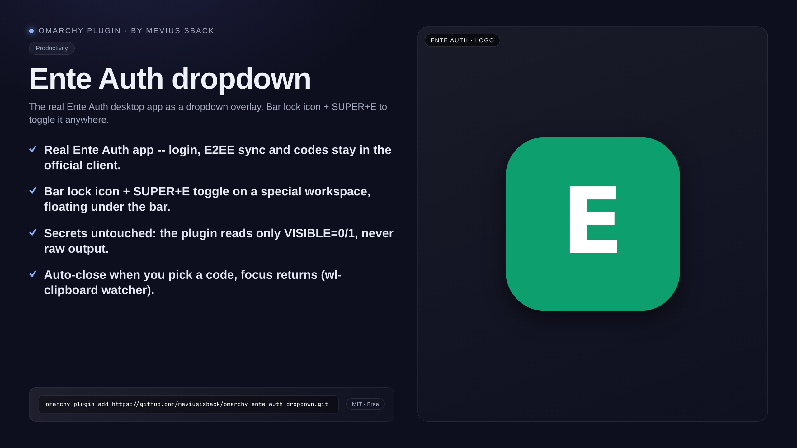

<div align="center">

# Ente Auth dropdown

**La vera app desktop di Ente Auth come dropdown in sovraimpressione: icona lucchetto sulla barra e toggle con `SUPER + E` ovunque tu sia.**

[](https://github.com/meviusisback/omarchy-ente-auth-dropdown/releases)
[](LICENSE)




</div>

## Perché esiste

I codici 2FA servono mentre stai facendo login da un'altra parte: aprire l'app
di autenticazione spezza il flusso e ti fa perdere il focus proprio quando devi
trascrivere cifre a tempo. Questo plugin tratta l'app ufficiale di Ente Auth
come un dropdown: una pressione di tasti e compare sopra quello che stai
facendo; quando scegli un codice si chiude da solo e il focus torna dov'era.
Login, sync E2EE e codici restano nell'app ufficiale.

## Cosa fa

- **Widget barra** (`BarWidget.qml`, plugin `meviusisback.ente-auth`): bottone
  icona, click = toggle, stato rilevato ogni 2 s. Non tocca segreti: legge solo
  `VISIBLE=0/1` e non logga mai l'output raw.
- **Dropdown su special workspace**: la finestra di Ente Auth vive nascosta e
  appare in sovraimpressione quando la chiami, da qualunque workspace.
- **Keybind globale `SUPER + E`** → `~/.local/bin/ente-auth-dropdown toggle`
  (installato da `install.sh`; nessun default keybind letto dal codice).
- **Auto-chiusura alla scelta del codice**: quando scegli un codice con la
  finestra di Ente attiva, il dropdown si nasconde da solo e il focus torna
  sulla finestra precedente (best-effort). Servono `wl-clipboard` e aver
  lanciato `./install.sh` almeno una volta.
- **Nessun segreto memorizzato**: login, sync E2EE e codici restano nell'app di
  Ente. Il watcher legge dagli appunti solo la dimensione in byte (per
  distinguere una copia dalla cancellazione automatica di Ente): il codice
  attraversa lo stdin del watcher come conteggio e non viene mai salvato,
  loggato o inoltrato.

## Installazione

```bash
omarchy plugin add https://github.com/meviusisback/omarchy-ente-auth-dropdown.git
omarchy plugin enable meviusisback.ente-auth
./install.sh
```

(`./install.sh` va lanciato dalla directory del plugin,
`~/.config/omarchy/plugins/meviusisback.ente-auth`.)

`install.sh` è idempotente (blocchi marcati, mai duplicati) e installa copie +
regola finestra + keybind + watcher + pulizia `shell.json`:

1. copia `ente-auth-dropdown` in `~/.local/bin/` (modo 755, verificato con `cmp`)
2. copia `hypr/ente-auth.lua` in `~/.config/hypr/`
3. aggiunge l'hook di caricamento in `~/.config/hypr/hyprland.lua`
4. aggiunge il keybind `SUPER + E` in `~/.config/hypr/bindings.lua` (il keybind
   esiste solo da questo passo in poi)
5. rimuove eventuali voci legacy `id == 'ente-auth'` di tipo command da
   `shell.json` (mai il widget del plugin)
6. ferma il watcher precedente (altrimenti resterebbe in esecuzione il vecchio
   codice), `hyprctl reload` + controllo `hyprctl configerrors`, poi avvia il
   nuovo watcher di auto-chiusura (parte comunque da solo a ogni reload/avvio
   successivo). Un `hyprctl reload` che fallisce (SSH/TTY, sessione non viva)
   stampa un warning e non interrompe l'installazione: in quel caso regola
   finestra e keybind diventano attivi solo al primo reload/login riuscito,
   mentre il watcher viene avviato subito da `install.sh` (e si riavvia da solo
   a ogni reload). Un blocco marker `BEGIN` senza `END` (o già doppio) fa
   rifiutare l'installazione invece di impilarne un secondo.

Poi posiziona il widget: `omarchy bar put meviusisback.ente-auth --section right`.

## Utilizzo

- `SUPER + E` ovunque: se l'app gira nascosta la mostra, se visibile la
  nasconde, se non gira la lancia.
- Click sul lucchetto nella barra: stessa cosa.
- Quando scegli un codice con la finestra di Ente attiva, il dropdown si chiude
  da solo e il focus torna dov'era. Funzionano anche `SUPER + E` (oppure `Esc`
  a lista visibile: è l'app stessa a chiuderlo). Se hai `special_fallthrough`
  attivo (lo imposta già il plugin dropdown-terminal, non questo script), basta
  anche cliccare fuori.
- Lo script chiede al compositor la lista delle finestre (e sposta la finestra
  fra i workspace); `status` riporta solo se il workspace speciale è mostrato
  (`VISIBLE=1`), non se la finestra esiste.

## Requisiti

- Omarchy con Hyprland 0.56+ (sintassi dispatcher Lua)
- App desktop Ente Auth installata (`ente-auth` da AUR, comando
  `/usr/bin/enteauth`)
- `wl-clipboard` (`wl-paste`) per l'auto-chiusura: senza quel pacchetto il
  toggle e il keybind funzionano lo stesso, il watcher semplicemente non parte
- Nerd Font per l'icona lucchetto nella barra

## Configurazione

- Keybind `SUPER + E`: vive in `~/.config/hypr/bindings.lua`, installato da
  `install.sh` (nessun default keybind letto dal codice).
- Comando di lancio: `/usr/bin/enteauth` nello script `ente-auth-dropdown`.
- Classe finestra: `hypr/ente-auth.lua` (default `io.ente.auth`).

## Come funziona

- Widget barra (`BarWidget.qml`, plugin `meviusisback.ente-auth`): bottone
  icona, click = toggle, stato rilevato ogni 2 s. Non tocca segreti: legge solo
  `VISIBLE=0/1` e non logga mai l'output raw.
- `hypr/ente-auth.lua` — regola finestra: la classe `io.ente.auth` va su
  `special:ente-auth`, flottante, centrata sotto la barra (70% larghezza x 50%
  altezza del monitor). Lo stesso file avvia il watcher di auto-chiusura
  all'avvio di Hyprland e dopo ogni `hyprctl reload`.
- `ente-auth-dropdown` — script di toggle: prima di decidere se l'app è già in
  esecuzione verifica classe `io.ente.auth` **e** eseguibile
  (`enteauth`/`ente-auth` da un percorso root-owned: `/usr/`, `/opt/`,
  `/var/lib/flatpak/`, `/snap/`, non scrivibile da group/other). Quella regola
  governa lancio, auto-chiusura e "porta la finestra nel workspace", non cosa
  mostra il workspace: la regola finestra in `hypr/ente-auth.lua` sposta lì
  qualunque finestra che dichiari quella classe (la classe è auto-dichiarata
  dal client). Se l'app gira nascosta la mostra, se visibile la nasconde, se
  non gira la lancia (`/usr/bin/enteauth`, AUR). Usa la sintassi dispatcher Lua
  di Hyprland 0.56 (`hl.dsp.workspace.toggle_special`); quella legacy
  `togglespecialworkspace` su questa build fallisce in silenzio.
- Auto-chiusura (`ente-auth-dropdown watch`): Ente Auth copia il codice negli
  appunti Wayland quando clicchi una voce, e quel cambio di selezione è l'unico
  segnale che l'app espone. Il watcher (`wl-paste --watch`) reagisce solo se la
  finestra attiva è proprio l'app di Ente (stessa regola: classe + eseguibile
  `enteauth` da percorso root-owned): nasconde il dropdown e il focus torna
  sulla finestra precedente. Del contenuto degli appunti legge solo la
  **dimensione** (per distinguere una copia dalla cancellazione automatica di
  Ente): il codice non viene mai salvato, loggato o passato altrove. È un
  singleton (`flock`), quindi i reload non ne accumulano copie.

## Rimozione

```bash
./install.sh uninstall
omarchy plugin disable meviusisback.ente-auth
omarchy plugin remove meviusisback.ente-auth
```

Rimuove script, regola, hook e keybind, ferma il watcher, poi `hyprctl reload`.
Restano i backup `hyprland.lua.bak` e `bindings.lua.bak` (cancellali a mano se
non servono), le modifiche a `shell.json` (le voci legacy restano rimosse) e la
directory di stato del watcher `$XDG_RUNTIME_DIR/ente-auth-dropdown` (lock,
lock degli eventi clipboard, pid e finestra-precedente: sparisce al riavvio
della sessione; se `XDG_RUNTIME_DIR` non è impostato il fallback è
`/tmp/ente-auth-dropdown.<uid>`, che **non** sparisce). Da un'installazione ≤
1.1.0 può restare anche il vecchio lock
`$XDG_RUNTIME_DIR/ente-auth-dropdown.watch.lock`: nessun codice lo rimuove.

## Licenza

MIT — vedi [LICENSE](LICENSE).
